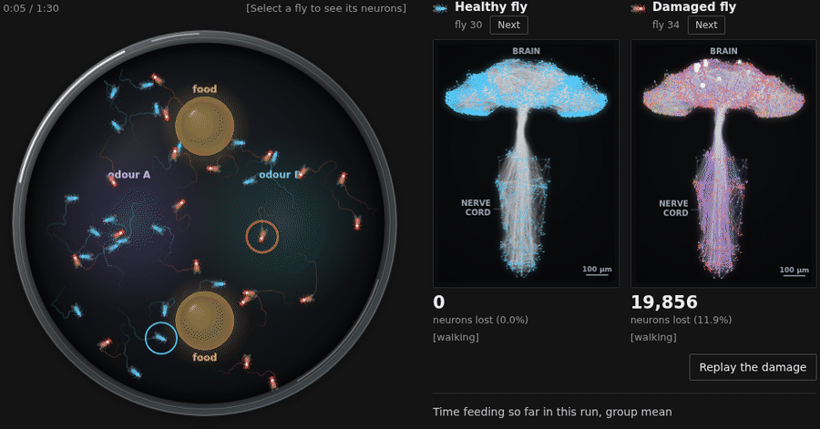

# adfly-connectome

Code, result tables and figures of an in silico model of amyloid-like pathology on the
*Drosophila* MaleCNS connectome.

**Manuscript:** Jo T. Simulating Alzheimer's amyloid-like pathology on a fly central nervous system connectome. arXiv:2610.19153, 2026. <https://arxiv.org/abs/2610.19153>.

**Interactive demo:** <https://www.jolab.ai/adfly/> plays a recorded 90-s run of 20 healthy flies and 20 flies at
severity 0.5 in a virtual arena, next to the neurons and their connections in one fly of each group, and redraws five
result charts from the tables in this repository. The run is an illustration; it is not the arena cohort of the
manuscript.

[](https://www.jolab.ai/adfly/)

The study simulates the adult male *Drosophila* central nervous system (MaleCNS v1.0,
166,700 leaky integrate-and-fire neurons) and applies graded amyloid-like pathology to it.
Everything here is the output of a simulation. No animal was used and no measurement was
made.

This repository holds the simulation engine, the scripts that built the network and ran each
design, the analysis and figure scripts, the per-fly result table of every design, the tables
of named values ("facts") from which every number in the manuscript is taken, and the
figures of the manuscript. The connectomes
themselves are not redistributed; the section "Obtaining the connectomes and rebuilding the
network" says where to get them.

Release `v1.0.0` is the state of the code and tables at submission.

## Layout

| Path | Contents |
|---|---|
| `code/adfly/` | The package: `build_pack.py` and `build_mb_edges.py` (MaleCNS network build), `lif.py` (engine), `model.py` (network, learning rule), `pathology.py` (the three pathology rules and the vulnerability maps), `counterfactual.py` (within-fly variants), `house_nb.py` (virtual arena, compiled into one kernel with the brains) and `house.py` (its arena and body parameters). |
| `code/scripts/` | Scripts that run the designs, analyse them, write the facts tables and draw the figures. The table under "Scripts" says what each one does. |
| `connectome/` | Records of the networks, without the networks: `manifest.json` (MaleCNS build record with the SHA-256 digest of each of the three source files), `network_digests.json` (digests of the built MaleCNS network files and the record of the rebuild and reruns of 10 October 2026) and `manifest_flywire.json` (digests and versions of the FlyWire and base-model files). |
| `results/` | Per-fly result tables and analysis outputs. The eight files `results/facts/facts_*.json` are the facts tables. |
| `media/` | `demo.gif` and `demo.png`, a recording and a still of the web illustration, shown at the top of this README. |
| `figures/` | The figures of the manuscript (Fig 1 to Fig 7, S1 Fig to S4 Fig) as PNG, PDF and TIFF, with the plotted values of Fig 4 and Fig 5 as JSON. |

All commands below are run from the top folder of the repository. Scripts find that folder
as the nearest parent folder that contains `results/`. The usage lines inside some scripts
write `python scripts/<name>.py`, the layout of the machine that ran them; here the path is
`code/scripts/<name>.py`.

## Requirements

Python 3.13 and the packages in `requirements.txt`:

```bash
python -m pip install -r requirements.txt
```

`requirements.txt` pins the versions of the Windows PC that wrote the facts tables and the
figures. The simulations, the validation runs and the network build ran on a Linux machine
under Python 3.13.5 with newer versions of the same packages; `requirements-simulation.txt`
is the full list of that environment.

The figure scripts use the Arial font. Where Arial is not installed matplotlib substitutes
another font, and the text in the figures will not match the published files.

## Reproducing the numbers

No connectome is needed for this. The eight scripts read the result tables in `results/`,
the build record in `connectome/` and the code, and each writes one facts table:

```bash
python code/scripts/facts_model.py        # results/facts/facts_model.json
python code/scripts/facts_battery.py      # results/facts/facts_battery.json
python code/scripts/facts_detection.py    # results/facts/facts_detection.json
python code/scripts/facts_exp1.py         # results/facts/facts_exp1.json
python code/scripts/facts_exp2.py         # results/facts/facts_exp2.json
python code/scripts/facts_extra.py        # results/facts/facts_extra.json
python code/scripts/facts_validation.py   # results/facts/facts_validation.json
python code/scripts/facts_text.py         # results/facts/facts_text.json
```

On Windows, set `PYTHONIOENCODING=utf-8` first. `facts_detection.py` takes two to three
minutes; the others take between a few seconds and about a minute.

`facts_text.json` holds the values quoted in the text that the other tables do not hold.
Run `facts_text.py` last. It reads five of the tables above (`facts_battery.json`,
`facts_detection.json`, `facts_exp1.json`, `facts_exp2.json` and `facts_model.json`), takes
the definitions of its statistics from the source of `facts_battery.py`,
`facts_detection.py`, `facts_exp2.py` and `analyze_joint.py`, and stops if a value
it recomputes differs from the one those tables hold. For one interval of Fig 3C it repeats
the drawing calls of `make_figures.py` in memory, so it needs matplotlib; it writes no
figure.

Each facts file is a flat table of named values. Its `_meaning` entry gives one sentence per
value saying what it is, and `_source`, where present, names the file and column or the code
line it comes from. To find the value behind a statement in the manuscript, search the
`_meaning` entries by keyword.

What each table holds:

| Table | Contents |
|---|---|
| `facts_model.json` | The model: connectome build, engine validation, weight and adaptation calibration, feedforward antennal lobe, MaleCNS gustatory check, base-model probes, pathology rules and vulnerability rank, parameters of the circuit protocol and the arena. Most values are read from result files or from the code. The script also simulates one isolated neuron, to count the spikes per input event. |
| `facts_battery.json` | The four battery designs: severity series, rule ablation, map comparison, Kenyon-cell-only scenario, replicate groups. |
| `facts_detection.json` | Learning, motor and high-activity phenotypes, separation from healthy (AUCs, first crossings, the flies simulated twice), joint cohort and arena. |
| `facts_exp1.json` | Within-fly analysis. |
| `facts_exp2.json` | Burden-matched comparison. |
| `facts_extra.json` | The split of lost contacts between thinning and removed neurons, the highly connected types of the within-fly screen, the odour persistence of the 0.157-mV calibration and the chance level of the direction-free AUC. |
| `facts_validation.json` | Engine validation at the input rate of each reference (150, 200 and 100 Hz). |
| `facts_text.json` | Values quoted in the text that the other tables do not hold, such as the exact permutation p values, the projection neuron share of the whole-brain count and the shuffled/hub ratios against each hub group. |

The facts scripts recompute a value from the result tables and the code or, where the
`_meaning` entry says so, copy it from the output of an analysis script.

`facts_extra.py` computes the chance level of the direction-free AUC, max(AUC, 1 − AUC),
exactly from the null distribution of the Mann-Whitney statistic without ties: mean 0.550
(95th percentile 0.623) for 32 against 64 flies and 0.563 (0.654) for 24 against 32 flies.
It confirms these with a simulation of 20,000 pairs of independent standard normal samples,
which gives 0.550 (0.624) and 0.563 (0.655).

The tables hold more values than the manuscript quotes. Three that the text does not give:
at 48.3% of contacts lost, 5 hub and 4 shuffled flies of the burden-matched comparison had
giant fibre output below 100 Hz (`syn48.3_hub_n_GF_below100Hz` and
`syn48.3_shuffled_n_GF_below100Hz` in `facts_exp2.json`); a Fisher exact test of that count
between the two hub groups at s = 0.5, of the burden-matched comparison and of the map
comparison, gave p = 0.36 (`hubs05_exp2_vs_mapcomp_GF_fail_fisher_p`); and among the 24
screen flies at s = 0.5 the fraction of the whole-brain deficit restored by restoring all
removed neurons correlated negatively with the number of neurons removed (Spearman
ρ = −0.62, `f.WB_neuron_share_vs_n_removed_s0.5` in `facts_exp1.json`).

The committed facts files were written by these scripts. After a rerun, `git diff results/`
should be empty. I checked this on Windows 11 with Python 3.13.3 and the pinned package
versions. In the environment of `requirements-simulation.txt` (Linux, newer package
versions) I ran the first seven scripts: six of their files came out identical, and in
`facts_exp1.json` one list, `e.best_MN9_type_identity`, had its two tied entries in the
other order. `facts_text.py` was written after that check and has been run in the first
environment only. On other systems expect the values to agree to the rounding the scripts
apply, and tied entries of a list to change places. On Windows the scripts write Windows
line endings, so `git status` may list the rewritten files as modified although `git diff`
shows no change.

## Reproducing the figures

To draw the figures:

```bash
python code/scripts/make_figures.py       # Figs 1, 2, 3, 6 and 7, S1 Fig to S4 Fig
python code/scripts/make_fig4_burden.py   # Fig 4 and figures/Fig4_values.json
python code/scripts/make_fig5_rescue.py   # Fig 5 and figures/Fig5_values.json
```

The figure scripts read `results/` and the facts tables and write to `figures/`. Each
checks part of what it plots against the facts tables and stops on a mismatch:

- `make_fig5_rescue.py` checks its plotted medians and intervals. The cells of Fig 5E
  and the type medians of Fig 5F are checked against the summary tables of
  `analyze_exp1.py`.
- `make_fig4_burden.py` checks every plotted group median and the matched severities and
  burdens. Its intervals come from its own resamples.
- `make_figures.py` checks selected counts and values printed or plotted in its figures:
  cohort size, motor and high-activity counts, first crossings, healthy spread and the AUCs
  of the joint cohort (S4 Fig). Its other values, such as the medians and intervals of
  Fig 2, Fig 3 and S3 Fig and the AUC curves of Fig 7A, are computed from the per-fly tables
  or taken from the outputs of `analyze_battery.py` (those of S1 Fig from the outputs of the
  engine validation scripts) and are not checked against the facts tables.

Intervals drawn in Fig 3, Fig 4 and S3 Fig can therefore differ slightly from those quoted
in the text; "Seeds and run details" gives the size of the difference. The Fig 4 and Fig 5
scripts import their plotting helpers from `figure_common.py`; importing it creates an empty
`figures/scratch/` folder, which can be deleted.

PNG and TIFF files come out identical to the committed ones when the package versions and
the font are the same. PDF files differ only in their embedded creation time.
`python code/scripts/check_figures.py figures` checks size, resolution and text size of
the figure files (it needs PyMuPDF).

## Obtaining the connectomes and rebuilding the network

The simulations need the connectome, which I do not redistribute.

### MaleCNS v1.0

MaleCNS v1.0 is released under CC BY 4.0 (Berg et al. 2026). Download these three files from
<https://storage.googleapis.com/flyem-male-cns/v1.0/connectome-data/flat-connectome/>
(listed at <https://male-cns.janelia.org/download/>) into `data/malecns_v1.0/`:

- `body-annotations-male-cns-v1.0-minconf-0.5.feather`
- `body-neurotransmitters-male-cns-v1.0.feather`
- `connectome-weights-male-cns-v1.0-minconf-0.5.feather`

Their SHA-256 digests are in `connectome/manifest.json`. Then build the network:

```bash
python code/adfly/build_pack.py       # writes data/pack/malecns_v1.0/ and prints its manifest
python code/adfly/build_mb_edges.py   # adds mb_edges_raw.parquet to that folder
```

`build_pack.py` keeps every body with a superclass annotation (166,700 neurons, ordered by
body identifier) and every edge whose presynaptic neuron is predicted to release
acetylcholine (+1), GABA (−1) or glutamate (−1): 24,469,412 signed edges. The printed
manifest should equal `connectome/manifest.json`. `build_mb_edges.py` writes the unsigned
edges among Kenyon cells, MBONs and the PAM and PPL1 dopaminergic neurons (996,383 rows),
from which the model derives which MBON types belong to the compartment of each
dopaminergic type; dopaminergic neurons carry no sign and are therefore absent from the
signed network.

I checked the build on 10 October 2026: both scripts were run from the three source files in
a separate folder, and all seven files they wrote were byte-identical to the network that
every simulation had loaded. `connectome/network_digests.json` holds the SHA-256 digest of
each file, so a rebuild can be checked. The `.npy` files depend only on the source tables;
the two parquet files are byte-identical only with the pandas and pyarrow versions of
`requirements-simulation.txt` and should otherwise be compared by value.

One of the seven files has a history. `mb_edges_raw.parquet` of the network in use was
written on 2 October 2026 by a step that was not saved as a script. `build_mb_edges.py` was
written afterwards to reproduce that file from the source tables, and the check above shows
that it does so byte for byte.

The two scripts took 33 and 22 seconds.

### FlyWire v630 and v783, and the base model

These are used only for the engine validation and the weight calibration. The connectivity
and completeness tables are the ones distributed with the base model of Shiu et al. (2024),
<https://github.com/philshiu/Drosophila_brain_model>. I used commit `91bdd1e` of
14 September 2024.

1. Clone that repository into `ext/Drosophila_brain_model/`.
2. Copy its four table files (`2023_03_23_completeness_630_final.csv`,
   `2023_03_23_connectivity_630_final.parquet`, `Completeness_783.csv`,
   `Connectivity_783.parquet`) into `data/shiu2024/`.
3. Copy its two example outputs, `results/example/sugarR.parquet` and
   `results/example/sugarR_100Hz.parquet`, into `data/shiu2024/example/`.
4. For the weight calibration, save the FlyWire neuron annotations,
   `supplemental_files/Supplemental_file1_neuron_annotations.tsv` of
   <https://github.com/flyconnectome/flywire_annotations>, as
   `data/flywire/fw_neuron_annotations.tsv`. I used the file as of commit `a83b277` of
   29 September 2026.

`connectome/manifest_flywire.json` records the SHA-256 digest, the size and the git blob
identifier of each of these files as I used them, and the digests of the two FlyWire
networks compiled from them. FlyWire data are released under CC BY-NC 4.0.

## Rerunning the engine validation

The engine is compared with Brian2 running the unmodified published model on FlyWire v630
(21 sugar-sensing neurons driven by Poisson input, 30 trials of 1 s), at three input rates:
150 Hz, the default of the published code, and 200 and 100 Hz, the rates at which the two
example outputs distributed with that code were generated. Brian2 2.10.1 is needed for the
three reference runs only.

```bash
python code/scripts/validate_engine_flywire.py        # builds data/pack/flywire_630 from the v630 tables

# 150 Hz
python code/scripts/rerun_brian2_sugarR.py            # Brian2 reference run at the default rate
python code/scripts/validate_engine_final.py          # results/validation/engine_validation.json (S1 Fig A and C)

# 200 Hz and 100 Hz
python code/scripts/rerun_brian2_sugarR_rate.py 200   # Brian2 reference run at 200 Hz
python code/scripts/rerun_brian2_sugarR_rate.py 100   # Brian2 reference run at 100 Hz
python code/scripts/validate_engine_200hz.py          # results/validation/engine_validation_200hz.json (S1 Fig B and D)

python code/scripts/facts_validation.py               # the values quoted in the manuscript
```

Points to know:

- The Brian2 runs are not seeded (the published code sets no seed), so a new run is another
  realisation of the same comparison, not the same spikes. The three reference runs the
  manuscript reports are stored in `results/validation/brian2_rerun/`, `brian2_rerun_200hz/`
  and `brian2_rerun_100hz/`, and the two Brian2 scripts never overwrite an existing output.
  To make a new reference run, move the stored `sugarR.parquet` of that folder away first.
- The engine runs are seeded: three input seeds (7, 11 and 12) at each rate. The per-neuron
  comparisons and every panel of S1 Fig use the 30-trial realisation of seed 7; ranges
  quoted in the manuscript are over the three seeds. With the stored reference runs in
  place, `validate_engine_final.py` and `validate_engine_200hz.py` reproduce the stored
  per-neuron rates and comparison values exactly; I checked this on 10 October 2026.
- `Brains` in `code/adfly/lif.py` has the option `gate_refractory_input`. When it is true,
  which is the default and the setting of every simulation of the manuscript, synaptic input
  that arrives during a neuron's refractory period is discarded; when it is false, the input
  is accumulated. Both validation scripts run both settings (discarded in S1 Fig A and B,
  accumulated in C and D). Correlations and slopes are computed on linear rates, over the
  neurons active in either run; the slope is an ordinary least-squares fit of the engine
  rate on the reference rate.
- `validate_engine_final.py` also compares its 150-Hz engine run with the distributed example
  output, which was generated at 200 Hz. That comparison is at unequal input rates; the
  like-for-like comparison is the one in `engine_validation_200hz.json`.
  `validate_engine_flywire.py` likewise prints an early 150-Hz comparison and writes it to
  `results/validation/engine_vs_brian2_flywire630.json`, which is not used and not kept here.
- If the compiled Brian2 code fails to load with a `GLIBCXX ... not found` error, the Python
  interpreter is loading an older `libstdc++` than the compiler that built the code. On the
  cluster I used, preloading the newer library for the process solved it
  (`LD_PRELOAD=<libstdc++.so.6 of the compiler> python ...`).

Each Brian2 run took between half a minute and two minutes with 30 processes, and the two
engine scripts about one and two and a half minutes on 48 cores.

The other model-building runs:

```bash
python code/scripts/validate_sugar_mn9.py     # MaleCNS gustatory check
python code/scripts/calibrate_wsyn.py         # synapse-count ratio and weight tests (builds data/pack/flywire_783)
python code/scripts/sweep_adaptation.py       # adaptation sweep
python code/scripts/test_ff_al.py             # feedforward antennal lobe test
python code/scripts/probe_circuits.py         # base-model probes of persistence, looming and steering
python code/scripts/export_hub_rank.py        # results/validation/hub_vulnerability_u.npz
```

## Rerunning the designs

With `data/pack/malecns_v1.0/` in place, each result table is written by one command. These
are the 1,424 flies of the manuscript and the within-fly analysis.

```bash
# the four battery designs: 384, 320, 192 and 64 flies
python code/scripts/assay_battery.py --design stage_curve   --scale 4 --out stage_curve_x4.csv
python code/scripts/assay_battery.py --design components    --scale 4 --out components_x4.csv
python code/scripts/assay_battery.py --design vulnerability --scale 4 --out vulnerability_x4.csv
python code/scripts/assay_battery.py --design scope         --scale 4 --out scope_x4.csv

# joint cohort: 176 flies, circuit readouts and 120 s in the arena
python code/scripts/cohort_joint.py --stage-list "0:32,0.05:24,0.1:24,0.15:24,0.2:24,0.3:24,0.5:24" --seconds 120 --out cohort_joint.csv

# burden-matched comparison: 288 flies
python code/scripts/exp2_burden_matched.py calibrate
python code/scripts/exp2_burden_matched.py run --n 32
python code/scripts/analyze_exp2.py

# within-fly analysis: 48 flies of the severity series, re-simulated
python code/scripts/exp1_counterfactual.py screen --stage 0.5 --n-flies 24 --batch 64
python code/scripts/exp1_counterfactual.py screen --stage 0.3 --n-flies 24 --batch 64
python code/scripts/analyze_exp1.py
python code/scripts/exp1_counterfactual.py robust  --stage 0.5 --n-flies 12 --batch 64
python code/scripts/exp1_counterfactual.py confirm --stage 0.5 --n-flies 12 --batch 16
python code/scripts/analyze_exp1.py

# analyses of the per-fly tables
python code/scripts/output_neuron_loss.py
python code/scripts/analyze_battery.py
python code/scripts/analyze_joint.py --csv results/joint/cohort_joint.csv
python code/scripts/exp1_stats.py         # results/stats/exp1_stats.json, after analyze_exp1.py
python code/scripts/exp2_stats.py         # results/stats/exp2_stats.json, after analyze_exp2.py
```

The seeds are the defaults of the scripts, so these commands repeat the reported runs;
"Seeds and run details" lists them. The battery and joint-cohort commands replace the table
that is in `results/`; `git diff` then shows whether anything changed. The burden-matched
run and the within-fly phases continue an interrupted run and skip flies whose output
exists. To repeat them, move `results/exp2/battery.csv` or the per-fly files under
`results/exp1/` away first, or pass `--redo` to `exp1_counterfactual.py`.

The analysis scripts (`analyze_battery.py`, `analyze_joint.py`, `analyze_exp1.py`,
`analyze_exp2.py`) and the two statistics scripts (`exp1_stats.py`, `exp2_stats.py`) read
only the stored tables, need no connectome and rewrite their outputs in `results/`.
`exp1_stats.py` reads the summary tables of `analyze_exp1.py`, and `exp2_stats.py` the
summary of `analyze_exp2.py`, so each runs after its analysis script. Both run before the
facts scripts, three of which read what they write: `facts_battery.py` and `facts_exp1.py`
read `exp1_stats.json`, and `facts_exp2.py` reads `exp2_stats.json`.

The outputs of `analyze_joint.py`, `analyze_exp1.py` and `analyze_exp2.py` were written in
the environment of `requirements-simulation.txt`, and those of `analyze_battery.py` in that
of `requirements.txt`. I checked on 10 October 2026 that each of these four scripts
reproduces its stored outputs byte for byte in the environment that wrote them, and on
11 October 2026 that `exp1_stats.py` and `exp2_stats.py` reproduce theirs byte for byte in
the environment of `requirements.txt`. For the four analysis scripts, some values differ in
the last digits in the other environment (relative differences below 10^-9).
`analyze_exp1.py` then also orders tied cell types differently: it ranks the types by their
median restored fraction with a sort that does not keep the order of ties, and for MN9
drive only six types have a positive median while 2,331 are tied at zero. The order of tied
rows in `types_ranked.csv` and `neurons_ranked.csv` changes, and with it
`results/exp1/top_units.csv`: four of the ten MN9 types and the draw of the ten control
types. The stored `top_units.csv` is the list the robust and confirm phases were run with.
With a list whose control types were drawn anew, `facts_exp1.py` fails with a `KeyError`,
because those types are not in the stored confirm runs. After rerunning the analysis
scripts with other package versions, restore the stored files with `git checkout -- results`
before running the facts scripts.

These runs are long. On the machine I used (48 logical cores), the Kenyon-cell-only design
(64 flies) took 11 minutes, the rule ablation (320 flies) 56 minutes, the joint cohort
3.9 hours and the within-fly screen 33 to 40 minutes per fly (29 hours for the 48 flies).
Each fly in a batch keeps its own copy of the 24.5 million synaptic weights (about 98 MB),
so memory grows with the batch size.

### Trying the code without the connectome

`make_test_pack.py` writes a small synthetic network (2,493 neurons) with the same file
layout and the cell types the protocol stimulates and reads. Its dynamics mean nothing
biologically, but it lets the simulation code run in seconds:

```bash
python code/scripts/make_test_pack.py --out data/pack/malecns_v1.0
python code/scripts/assay_battery.py --design scope --out smoke_scope.csv
python code/scripts/exp1_counterfactual.py screen --pilot --n-flies 2 --flies-csv data/pack/malecns_v1.0/stage_curve_x4.csv --out results/exp1_test
```

The second command simulates 16 flies and writes `results/battery/smoke_scope.csv`. The
third rebuilds two flies of a stand-in severity table from their seeds, checks the rebuilt
sets and runs a short within-fly screen into `results/exp1_test/`. Delete
`data/pack/malecns_v1.0/` and the smoke output before building the real network.

Take care with other scripts on the synthetic network: they write to the same files as the
real runs. Give a run its own output name where the script has an `--out` option.
`export_hub_rank.py`, `validate_sugar_mn9.py`, `sweep_adaptation.py`, `test_ff_al.py`,
`probe_circuits.py` and `learning_test.py` have none and replace the stored results;
`git checkout -- results` restores them. `output_neuron_loss.py` stops on the synthetic
network, because it checks every rebuilt fly against the stored severity series.

## How a fly is reproduced from its seed

Each simulated fly draws its pathology from a generator seeded with 10,000 plus its own
identifier (the `seed` column of the result tables). The draws are made in a fixed order:
the shuffled permutation (shuffled map only), the thinning of each neuron's output synapses,
and the removal of neurons. The damage of any fly can therefore be rebuilt without
simulating it:

```python
import sys; sys.path.insert(0, "code")
import numpy as np
from adfly import pathology
from adfly.model import Connectome, W_SYN

cx = Connectome()                                   # needs data/pack/malecns_v1.0
rng = np.random.default_rng(10_000 + 1256)          # fly 1256 of the severity series, s = 0.5
w, dth, dead, load = pathology.apply(pathology.Stage(s=0.5), rng, cx.row_ptr, cx.dst,
                                     cx.signed, W_SYN, cx.vuln, cx.is_kc, ~cx.sensory)
dead.sum()                                          # 19,541 removed neurons
```

The count equals `dead_frac` × 166,700 for that fly in `results/battery/stage_curve_x4.csv`.
`output_neuron_loss.py` and `exp1_counterfactual.py` make this check, to within 10^-9 of the
stored fraction, for every fly they rebuild, and stop if it fails.

A fly's readouts also depend on its input noise. Input spikes are drawn for a whole batch
at once from a generator seeded by the stimulus seed and the batch's position in the run, so
the readouts of a fly are reproduced by rerunning its design with the default batch size and
seed. I checked this on 10 October 2026 by rerunning the Kenyon-cell-only design (64 flies)
with this code on the rebuilt network, on the machine and in the environment of the original
run: the table came out byte-identical to `results/battery/scope_x4.csv`
(`connectome/network_digests.json` records this and the other reruns of that day). I have
not compared machines or package versions.

## Seeds and run details

Every reported run used the default seeds of its script, so the commands under "Rerunning
the designs" repeat it. This section lists those seeds and the run details that the
manuscript does not print.

Two kinds of seed are involved. The pathology seed of a fly is the `seed` column of its
result table; its damage is drawn from a generator seeded with 10,000 plus that number
(previous section). The input seed, or stimulus seed, of a run sets the Poisson input spikes
of its flies.

### The six designs

| Design | Command | Flies | Pathology seeds | Input generator of a batch |
|---|---|---|---|---|
| Severity series | `assay_battery.py --design stage_curve --scale 4` | 384: 64 healthy and 32 at each of s = 0.05, 0.10, 0.15, 0.2, 0.3, 0.4, 0.5, 0.6, 0.75 and 1.0 | 1000 to 1383 | 700 + batch offset |
| Rule ablation | `assay_battery.py --design components --scale 4` | 320: five conditions (all three rules, all but the threshold shift, each rule alone) at s = 0.5 and 1.0, 32 flies each | 2000 to 2319 | 700 + batch offset |
| Map comparison | `assay_battery.py --design vulnerability --scale 4` | 192: hub, shuffled and antihub maps at s = 0.5 and 1.0, 32 flies each | 3000 to 3191 | 700 + batch offset |
| Kenyon-cell-only scenario | `assay_battery.py --design scope --scale 4` | 64: s = 0.5 and 1.0, 32 flies each | 4000 to 4063 | 700 + batch offset |
| Burden-matched comparison | `exp2_burden_matched.py run --n 32` | 288: 32 healthy; hub, shuffled and antihub maps at 11.5% and 27.1% of contacts lost; hub and shuffled maps at 48.3%; 32 flies each | 6000 to 6287 | 1,100 + batch offset (stimulus seed 11) |
| Joint cohort | `cohort_joint.py`, with the options given under "Rerunning the designs" | 176: 32 healthy and 24 at each of s = 0.05, 0.10, 0.15, 0.2, 0.3 and 0.5 | 5150 + 13i for i = 0 to 175 (5150 to 7425) | see the joint-cohort table below |

The first four rows are the four battery designs. The joint cohort is all on the hub map.

**Batches.** Each of the four battery designs, and the burden-matched comparison, ran in
batches of 48 flies. The conditions of a design were permuted across batch positions (in the
four battery designs with permutation seed 7), so that batch effects cannot coincide with
condition. The joint cohort was simulated in one batch, with severities permuted across
positions. In `assay_battery.py` and `exp2_burden_matched.py` one option, `--seed`, sets both
this permutation and the input generator.

**Input spikes.** They are drawn for a whole batch at once. In the four battery designs the
generator of a batch is seeded with 700 plus the batch's offset in the run order (the
position of its first fly). The burden-matched comparison used stimulus seed 11 in the same
way: 1,100 plus the batch offset. A fly's readouts therefore depend on its batch and on its
position in it, and are reproduced by a run of the whole design with the default batch size
and seed.

**Input shared between designs.** The four battery designs used the same stimulus seed, so
flies that sat in the same position of the same batch in two designs received identical
input trains. Among the three default-model groups (severity series, rule ablation with all
three rules, map comparison with the hub map) this concerns 5 pairs of flies at s = 0.5 and
7 at s = 1.0. Of the 32 flies of each rule-ablation, map and Kenyon-cell-only group, 3 to 10
sat in the position of a healthy series fly. In the last batch of the rule-ablation and
Kenyon-cell-only designs, which held fewer than 48 flies, the trains were identical only
during the first odour presentation. Conditions were permuted into positions, so the sharing
adds no bias, but the groups concerned are not fully independent in input noise.

**Joint cohort.** Its seeds:

| Use | Seed |
|---|---|
| Pathology of fly i | 5150 + 13i |
| Circuit assays before training, and memory test | 5151 |
| Naive-valence probe | 3 |
| Training | 1 |
| Threat times and positions, drawn once and shared by all flies | 5152 |
| Arena: input and body noise of each fly | the fly's own stream, derived from the arena seed 5150 |

The reset of the dynamic state between the circuit assays and the naive-valence probe clears
membrane potentials, synaptic variables, adaptation and the refractory and delay buffers,
and keeps the synaptic weights. The state is reset again when the arena starts.

**Seeds shared between cohorts.** The burden-matched seeds overlap no seed of the four
battery designs or of the within-fly analysis. Twenty-two of them coincide with joint-cohort
seeds: 6008 to 6281 in steps of 13, which belong to 2 healthy, 8 hub, 7 shuffled and
5 antihub flies of the burden-matched comparison. In 18 of these pairs both flies carry
pathology drawn from the same random stream, at different severities or maps except for one
pair (seed 6242, hub map at s = 0.5 in both), whose pathology is identical. The two cohorts
are never compared with each other, so the overlap affects no reported statistic.

### Burden curves of the burden-matched comparison

`exp2_burden_matched.py calibrate` draws, without simulating them, the pathology of three
flies per map (seeds 90000 to 90002) at every severity from 0.05 to 1.0 in steps of 0.05 and
writes their burden to `results/exp2/calibration.csv`. The mean burden of the three flies is
interpolated linearly between severities to find the matched severities
(`results/exp2/matched.json`). The burden that each simulated fly received was recomputed
from its seed.

### Within-fly analysis

| Phase | Command | Flies of the severity series |
|---|---|---|
| Screen | `exp1_counterfactual.py screen` | The first 24 by seed at s = 0.3 (seeds 1192 to 1215) and at s = 0.5 (seeds 1256 to 1279) |
| Robustness test | `exp1_counterfactual.py robust` | The first 12 at s = 0.5 (seeds 1256 to 1267) |
| Full protocol | `exp1_counterfactual.py confirm` | The same 12 flies |

All 48 flies are on the hub map, and the rebuilt fraction of removed neurons matched the
stored value exactly in every fly. The seeds of the phases:

- **Input.** Every variant of a fly starts from a reset state and receives the same Poisson
  input, drawn from seed 777,000 plus the fly's seed. A variant gives identical readouts
  wherever it is placed in a simulation batch, so the batch size does not change the
  result. The full protocol uses the same input seed as the screen and as the base model of
  the robustness test.
- **Random class combinations of the screen.** Each of the 256 combinations of a fly
  includes each damaged class independently with probability 0.5, from a generator seeded
  with 31,000 plus the fly's seed. The same generator then draws the fly's 50 control types.
- **Further input-noise realisations of the robustness test.** The input seed plus 1,000,000
  and plus 2,000,000, with model and pathology unchanged.

Labels and selection rules:

- **The label `sc:`.** A class is the class annotation of MaleCNS or, where a neuron has
  none, its superclass. The result tables write such a stand-in with the prefix `sc:`. For
  example, `sc:cb_intrinsic` is the set of central-brain intrinsic neurons without a finer
  class label, and `sc:descending_neuron` is the descending-neuron class. Cell types come
  from the type annotation, and untyped neurons are grouped by class.
- **Types tested in the screen.** All damaged types in the chosen classes were sorted by the
  number of neurons the fly had lost in each, largest first, and the first 400 were tested.
  Types with equal numbers were taken in the order of the index of their first neuron.
- **Types of the robustness set.** Types were ranked for each readout by their median
  restored fraction over the 48 screen flies, among types with a finite fraction in at least
  3 flies. For MN9 drive only six types had a positive median, and the other four of its ten
  were taken, in the order the sort returned them, from the 2,331 types tied at zero (see
  the note on tied types under "Rerunning the designs"). When rankings were compared between
  models, ties in the top 10 were broken in a fixed type order.
- **Types more important than the wiring predicts.**
  `results/exp1/summary/dynamic_outliers.csv` gives the median standardised
  leave-one-type-out residual of every type tested in at least 3 flies. That floor of 3 is
  the one of `analyze_exp1.py`, which was written before the screen. The manuscript lists
  the types with a median of at least 2 that were tested in at least 10 flies; this floor of
  10 was added after the screen and is applied in `facts_exp1.py`.

S1 Text describes some flies without giving their seed:

| Seed | s | Fly |
|---|---|---|
| 1203 | 0.3 | Projection neuron example: two DM4_adPN neurons restored |
| 1271 | 0.5 | Projection neuron example: the two VA2_adPN neurons restored |
| 1197, 1213, 1200 | 0.3 | High-activity flies of the screen (own-group criterion in the series) |
| 1266 | 0.5 | High-activity fly in which both APL neurons had been removed and APL was among the tested types |
| 1274 | 0.5 | High-activity fly whose MBON rate in the series (3.19 Hz) was above the healthy maximum, and in which the smallest chosen type had lost three neurons |

Fly-readout pairs kept with a damaged value above healthy: in the screen, Kenyon cell rate
in flies 1197 and 1200, MBON rate in 1197, 1200, 1266 and 1274, and MN9 drive in 1195, 1206,
1214 and 1277; in the robustness and full-protocol runs, further pairs in flies 1266 and
1257. The files of a fly in `results/exp1/screen/` carry its severity and seed in their
names (`s0.5_seed1266_runs.csv`).

### Engine validation and model-building runs

| Run | Script | Input seed |
|---|---|---|
| Engine validation, at each of the three input rates | `validate_engine_final.py`, `validate_engine_200hz.py` | 7, 11 and 12; S1 Fig shows seed 7 |
| MaleCNS gustatory check | `validate_sugar_mn9.py` | 0 |
| Synapse-count ratio, weight tests and persistence tests on MaleCNS and FlyWire v783 | `calibrate_wsyn.py` | 0 |
| Adaptation sweep | `sweep_adaptation.py` | 0 |
| Feedforward antennal lobe calibration | `test_ff_al.py` | 0 |
| Base-model probes, with the six unilateral olfactory receptor neuron stimuli (10 replicate brains) | `probe_circuits.py` | 0 |

The Brian2 reference runs are not seeded. The three exploratory tests whose scripts were not
kept record no seed ("Result tables").

- **Type matching for the synapse-count ratio.** `calibrate_wsyn.py` matches cell types
  between the two connectomes by the MaleCNS annotation `flywireType` and the FlyWire v783
  field `cell_type`.
- **Feedforward calibration.** The numbers of neurons still active after stimulus offset in
  `results/calibration/ff_al_test.json` (1 with adaptation and 11 without, for odour A) are
  means over the eight replicate brains, truncated to whole neurons.
- **Steering probe.** In the base model with olfactory receptor neuron input, unilateral
  odour drive moved the steering descending neurons DNa01 and DNa02 by at most 3.3 Hz,
  without consistent lateralisation (`results/probe/`). This was not tested in the final
  model.

### Bootstrap intervals

Unless stated otherwise, an interval is the 2.5th to 97.5th percentile over 4,000 bootstrap
resamples with replacement. The seed depends on the script that computed the value:

| Script | Seed | Used for |
|---|---|---|
| `analyze_battery.py` | 20261005 | First crossings and paired AUC differences of the severity series. Its AUC intervals per severity (the band of S4 Fig) use 2,000 resamples. |
| `analyze_joint.py` | 0 | First crossings and all-pairs tests of the joint cohort |
| `analyze_exp2.py` | 2 | Pre-specified ratios and verdicts of the burden-matched comparison |
| The facts scripts (`facts_*.py`) | 20261009; 20261010 in `facts_exp2.py`; 20261012 in `facts_extra.py`, which draws random numbers only for the simulation that confirms the chance level of the direction-free AUC | The values quoted in the manuscript. Among them are the intervals of the within-fly analysis and the column "Share crossed by s = 0.2" of the first-crossing table of S1 Text (Table G), which is a separate recomputation by `facts_detection.py`. |
| `make_figures.py` | 7 | Intervals drawn in Fig 3 and in S3 Fig B and C |
| `make_fig4_burden.py` | 20261010 | Intervals drawn in Fig 4, in another resampling order than the text values |

The intervals of Fig 5 are those of the text.

**Drawn against quoted intervals.** The intervals drawn in Fig 3, Fig 4 and S3 Fig come from the
resamples of the figure scripts and differ from those quoted in the text by Monte Carlo
error only: by at most 0.8 percentage points in Fig 4, and in Fig 3C the upper bound of the
hub-map MBON rate at s = 0.5 is drawn 5 points above the 59% quoted
(`fig3C_hub_s0.5_MBON_drawn_vs_text` in `facts_text.json`).

**Stability checks.** The facts scripts checked how far a bound depends on the bootstrap
draw:

- Battery designs (`facts_battery.py`): every interval was recomputed with 40,000
  resamples and, where a bound moved by more than 1 percentage point (0.01 for ratios), with
  8 further seeds. The entry `boot_unstable_bounds` of `facts_battery.json` records these
  bounds.
- Burden-matched comparison (`facts_exp2.py`): the intervals were recomputed with 20
  further seeds and the pre-specified verdicts with 300. At 48.3% of contacts lost the lower
  bound of the decision-rule interval averaged 1.259 over the 300 repeated bootstraps (range
  1.240 to 1.276), and 97% of them gave the same verdict (`syn48.3_primary_maxmin_lo_mc` and
  `syn48.3_primary_verdict_mc_agreement` in `facts_exp2.json`; its entry `_mc_check` records
  the settings of the check).
- Severity series: the intervals of projection neuron rate and PAM pairing rate at s = 0.5
  and 1.0 were recomputed with 20 further seeds.
- First crossings: when the cumulative share of resamples that had crossed was within 0.1 of
  one half at some severity, the bootstrap was repeated with 10 further seeds. A bootstrap
  median that changed between them is the one S1 Text calls not stable (MBON rate: 0.15 in
  8 and 0.2 in 3 of 11 bootstrap runs), and the observed crossing is quoted.
- The other intervals, those of the within-fly analysis included, were not checked in this
  way. Bounds whose second significant figure was not reproducible are quoted with fewer
  digits.

**Intervals quoted from 40,000 resamples.** A bound of the battery designs that was not
stable at 4,000 resamples is quoted from 40,000. These are:

- learning index divided by MBON rate in the severity series at s = 0.15, 0.2 and 0.4
  (Table A of S1 Text);
- the same ratio pooled over s = 0.10 to 0.3, whose upper bound ranged from 98.9 to 100.5%
  between seeds at 4,000 resamples, and pooled over s = 0.05 to 0.3;
- the same ratio in the rule ablation at s = 0.5, for synapse loss alone and for both loss
  rules without the threshold shift (Table C of S1 Text);
- in the rule ablation at s = 0.5, the learning index under the threshold shift alone, and
  MN9 drive under neuron loss alone and under synapse loss alone.

### The earlier run of the four designs, and the flies simulated twice

`results/battery/stage_curve.csv`, `components.csv`, `vulnerability.csv` and `scope.csv`
hold an earlier and smaller run of the four battery designs: 240 flies, 8 per condition and
16 healthy, written by `assay_battery.py` without `--scale 4`. It is not part of the 1,424
flies; the scripts and the facts tables call it the pilot. Its pathology seeds are the first
of each design's range (1000 to 1095, 2000 to 2079, 3000 to 3047 and 4000 to 4015), but they
fall on the conditions in another order than in the reported designs. A fly of the earlier
run therefore has both the seed and the condition of a reported fly only in the first
condition of each design: the 16 healthy flies of the severity series, and 8 flies each of
the rule ablation (all three rules), the map comparison (hub map) and the Kenyon-cell-only
scenario at s = 0.5. These 40 flies were thus simulated twice, with identical pathology and
different input noise, and the manuscript uses the pairs only for its test-retest comparison
(16 healthy, 16 pan-neuronal and 8 Kenyon-cell-only pairs). Every other seed of the earlier
run reappears in the reported designs under another condition or severity.

## Result tables

| Path | Contents | Written by |
|---|---|---|
| `results/battery/*_x4.csv` | One row per fly: severity series (384), rule ablation (320), map comparison (192), Kenyon-cell-only scenario (64). | `assay_battery.py` |
| `results/joint/cohort_joint.csv`, `cohort_joint_meta.json` | Joint cohort (176 flies): circuit and arena readouts of the same flies; arena settings and threat schedule. | `cohort_joint.py` |
| `results/joint/` (other files) | Trends, per-severity AUCs and paired AUC differences. | `analyze_joint.py` |
| `results/exp2/` | Burden-matched comparison: burden against severity, matched severities, per-fly table (288), pre-specified verdicts. | `exp2_burden_matched.py`, `analyze_exp2.py` |
| `results/exp1/screen/`, `robust/`, `confirm/` | Within-fly analysis: one row per simulated variant of each fly, per-fly class and type tables, the random half-rescue designs. | `exp1_counterfactual.py` |
| `results/exp1/summary/`, `top_units.csv` | Decomposition, class and type rankings, robustness and full-protocol summaries. | `analyze_exp1.py` |
| `results/validation/engine_validation*.json`, `*_rates.npz` | Engine against the published model on FlyWire v630, at 150 Hz and at 200 and 100 Hz: summaries and per-neuron rates. | `validate_engine_final.py`, `validate_engine_200hz.py` |
| `results/validation/brian2_rerun*/` | Spikes of the Brian2 2.10.1 runs of the published code at 150, 200 and 100 Hz, with a record of each run at 200 and 100 Hz. | `rerun_brian2_sugarR.py`, `rerun_brian2_sugarR_rate.py` |
| `results/validation/shiu_example_provenance.json` | History of the example output distributed with the published model, recorded by hand from that repository on 10 October 2026. | none |
| `results/validation/*_R.parquet`, `baseline_nostim.parquet`, `summary_sugar_mn9.json` | MaleCNS gustatory check: mean rate of every neuron under four conditions. | `validate_sugar_mn9.py` |
| `results/validation/hub_vulnerability_u.npz` | Hub rank `u` of every MaleCNS neuron. | see below |
| `results/calibration/calibration.json`, `matched_type_input_synapses.csv` | Synapse-count ratio between MaleCNS and FlyWire v783 and the weight tests. | `calibrate_wsyn.py` |
| `results/calibration/adaptation_sweep.*`, `ff_al_test.json` | Adaptation sweep; feedforward antennal lobe test. | `sweep_adaptation.py`, `test_ff_al.py` |
| `results/calibration/kckc_test.json`, `sensory_input_test.json`, `odor_intensity_sweep.csv` | Three exploratory tests without adaptation (synapses among Kenyon cells removed, input to sensory neurons removed, unitary weight lowered to 0.157 mV) and an exploratory odour intensity sweep. | not kept, see below |
| `results/probe/` | Base-model probes of persistence, looming and steering. | `probe_circuits.py` |
| `results/paper/output_neuron_loss.json` | Removed giant fibres and MN9 neurons of the 320 affected series flies, rebuilt from their seeds. | `output_neuron_loss.py` |
| `results/stats/battery_stats.json` and the six csv tables in that folder | Statistics of the four battery designs and the joint cohort. | `analyze_battery.py` |
| `results/stats/exp1_stats.json`, `results/stats/exp2_stats.json` | Summary statistics of the within-fly analysis and of the burden-matched comparison. The facts scripts read them: `facts_battery.py` takes the median and quartiles of the threshold-shift decomposition from the first, and `facts_exp1.py` and `facts_exp2.py` use them as cross-checks. | `exp1_stats.py`, `exp2_stats.py` |
| `results/facts/facts_*.json` | The facts tables. | `facts_*.py` |

Result files whose original script is not here:

- `kckc_test.json` (the Kenyon cell synapse test and the weight test),
  `sensory_input_test.json` and `odor_intensity_sweep.csv`. The steps that wrote them were
  not saved as scripts, so their protocol is inferred from
  the files. The control rows of the synapse and weight tests match the adaptation sweep
  exactly, so their protocol is taken to be that of the sweep. The sensory-input test and
  the intensity sweep have no such control row; for them the recurrent antennal lobe, the
  500- to 700-ms window and, for the sensory-input test, the stimuli of the sweep are
  assumed. The three exploratory tests record no input seed.
- `results/validation/hub_vulnerability_u.npz` was first written by a step that was not
  saved. `export_hub_rank.py` writes the same file from the network: run on the network in
  use, it gave both arrays identical to the stored ones, element for element.
- `results/house_20v20_s05_flies.csv`, the per-fly table of the web illustration run, was
  derived from the output of `run_house.py` by a step that was not saved.
- `results/paper/house_early_flies.csv`, the per-fly table of the early arena cohort (45
  flies: 9 healthy and 9 at each of s = 0.1, 0.2, 0.3 and 0.5), was written by an earlier
  analysis script from the output of an early arena run. Neither that script nor that
  output is kept here. `facts_detection.py` reads the file only to count its flies.

Three result files were edited after they were written, only to remove a folder or library
path of the machine that ran them: the `out` entry in the configuration of
`results/house_20v20_s05_full.json`, and the `ld_preload` entry of the two
`results/validation/brian2_rerun_*hz/run_info.json` files.

### Runs that are not part of the 1,424 flies

The manuscript does not count the following runs. Their tables are here because the facts
scripts read them, either to count them or, for the earlier run of the four battery designs,
for the test-retest comparison.

| Path | Run |
|---|---|
| `results/battery/stage_curve.csv`, `components.csv`, `vulnerability.csv`, `scope.csv` | Earlier and smaller run of the four battery designs, 240 flies. Forty of them have the seed and condition of flies of the reported designs, so those flies were simulated twice with identical pathology and different input noise; the pairs give the test-retest comparison. "Seeds and run details" has the layout. |
| `results/learning/learning_by_stage.csv` | Learning cohort, 30 flies (`learning_test.py`). |
| `results/paper/house_early_flies.csv` | Early arena cohort, 45 flies. The script that wrote the table is not here ("Result tables"). |
| `results/house_20v20_s05_full.json`, `results/house_20v20_s05_flies.csv` | The 40 flies of the web illustration of the arena at <https://www.jolab.ai/adfly/> (`run_house.py`): a precomputed 90-s run of 20 healthy flies and 20 flies at s = 0.5, with 7 threats and its own arena seed (2026). It is not the arena run of the manuscript. The result charts on that page are redrawn from the result tables in this repository and are not figures of the manuscript; the feeding times of the illustration run are not part of the manuscript. |
| `results/joint/smoke.csv`, `smoke_meta.json` | Four-fly technical test of the joint-cohort script. |

## Scripts

| Script | Role |
|---|---|
| `code/adfly/build_pack.py`, `build_mb_edges.py` | Build the MaleCNS network from the three source files. |
| `assay_battery.py` | Runs the circuit assay battery for one design. |
| `cohort_joint.py` | Runs the joint cohort: circuit assays, then the arena, in the same flies. |
| `exp2_burden_matched.py`, `analyze_exp2.py` | Burden-matched map comparison and its pre-specified analysis. |
| `exp1_counterfactual.py`, `analyze_exp1.py` | Within-fly analysis and its summaries. |
| `analyze_battery.py` | Statistics from the per-fly tables of the four battery designs (severity series, rule ablation, map comparison, Kenyon-cell-only scenario, replicate groups, AUCs per severity and first crossings) and, for the joint cohort, its AUCs and their comparison with the arena readouts. |
| `analyze_joint.py` | Joint cohort: trends, first crossings and all-pairs paired AUC differences. |
| `output_neuron_loss.py` | Rebuilds the removed neurons of each of the 320 affected flies of the severity series from its seed, and cross-tabulates giant fibre output below 100 Hz against removal of the left (stimulated-side) and right giant fibres, and MN9 silence against the number of MN9 neurons removed. |
| `validate_engine_flywire.py` | Builds the FlyWire v630 network that the engine validation loads. |
| `validate_engine_final.py`, `rerun_brian2_sugarR.py` | Engine validation at 150 Hz, the default rate of the published code, and its Brian2 reference run. |
| `validate_engine_200hz.py`, `rerun_brian2_sugarR_rate.py` | Engine validation at 200 and 100 Hz, the rates of the example outputs distributed with the published code, and the Brian2 reference runs at those rates. |
| `validate_sugar_mn9.py`, `calibrate_wsyn.py`, `sweep_adaptation.py`, `test_ff_al.py`, `probe_circuits.py` | MaleCNS gustatory check, weight comparison, adaptation sweep, feedforward antennal lobe calibration, base-model probes. |
| `facts_*.py` | Write the facts tables. |
| `make_figures.py`, `make_fig4_burden.py`, `make_fig5_rescue.py` | Draw the figures. |
| `figure_common.py` | Style, colours and plotting helpers imported by the Fig 4 and Fig 5 scripts and by the two scripts of the next row. |
| `exp1_stats.py`, `exp2_stats.py` | Write `results/stats/exp1_stats.json` and `results/stats/exp2_stats.json`. |
| `export_hub_rank.py` | Writes the hub rank of every neuron to `results/validation/hub_vulnerability_u.npz`. |
| `make_test_pack.py` | Writes the synthetic test network. |
| `check_figures.py` | Checks a figure folder against the figure requirements of the manuscript. |
| `learning_test.py`, `run_house.py` | Wrote two of the uncounted runs listed above. |

## What is not here

- The connectomes and the base model's data files (see above for where to get them).
- The manuscript text. It is available from arXiv (<https://arxiv.org/abs/2610.19153>) and, if accepted, will be available from the journal.
- The scripts of the three exploratory tests and of the odour intensity sweep, and the two
  unsaved steps and the earlier analysis script named under "Result tables".
- The page code of the web illustration. The data of its run are in `results/`.

## How the code was written and checked

The code was written with an AI coding assistant (Claude, Anthropic, used through Claude
Code) under the author's direction. The work used Claude API credits provided through
Anthropic's AI for Science program. The author defined the model, the designs and the
analyses, and is responsible for the code and the results. The checks below do not depend
on reading the code:

- **Engine.** `code/adfly/lif.py` is compared with Brian2 running the unmodified published
  model on FlyWire v630. Per-neuron firing rates agree at each of three input rates: Pearson
  correlation 0.9997 (slope 1.004, 438 neurons) at 150 Hz against the Brian2 run, 0.9998
  (slope 0.997, 452 neurons) at 200 Hz and 0.9996 (slope 1.000, 422 neurons) at 100 Hz
  against the example outputs distributed with the published code. The files are in
  `results/validation/` and the values in `results/facts/facts_validation.json`. The two
  extensions used on MaleCNS (spike-frequency adaptation and the feedforward antennal lobe)
  were not part of this comparison.
- **Recorded values.** Every number in the manuscript is a named entry of a facts table,
  written by a script from the result tables together with its definition. The facts scripts
  contain consistency checks and stop when one fails, and the figure scripts check what they
  plot against the same tables ("Reproducing the figures" says which values). How far the
  bootstrap intervals depend on the random draw was checked as listed under "Seeds and run
  details".
- **Seeds.** Each fly's damage is drawn from a seeded generator and can be rebuilt exactly;
  the analysis scripts verify this for every fly they rebuild (320 flies of the severity
  series and each re-simulated fly of the within-fly analysis).
- **Network and reruns.** The network was rebuilt from the three source files and came out
  byte-identical to the one all simulations had used. On it, a rerun of one reported design
  (64 flies) reproduced the stored table byte for byte, and reruns of the two engine
  validation scripts reproduced the stored values.

## Licence

The code is released under the MIT licence (`LICENSE`). The result tables, the figures and
the records in `connectome/` are released under CC BY 4.0, except the six files named below
(`LICENSE-DATA.md`).

Third-party material:

- **MaleCNS v1.0**: FlyEM at HHMI Janelia Research Campus, the University of Cambridge, the
  MRC Laboratory of Molecular Biology and Google Research; CC BY 4.0. Berg S, et al. Sexual
  dimorphism in the complete *Drosophila* male central nervous system connectome. Cell.
  2026;189:5504-5526.e15. doi:10.1016/j.cell.2026.08.015. Some result tables carry MaleCNS
  body identifiers, cell type names and synapse-count summaries.
- **Base model**: Shiu PK, et al. A *Drosophila* computational brain model reveals
  sensorimotor processing. Nature. 2024;634:210-219. doi:10.1038/s41586-024-07763-9. Code at
  <https://github.com/philshiu/Drosophila_brain_model> (MIT licence, copyright 2023 Philip
  Shiu and Nico Spiller). `code/adfly/lif.py` is a new implementation of that model's
  equations and parameter values. `THIRD_PARTY_NOTICES.md` reproduces its licence.
- **FlyWire**: Dorkenwald S, et al. Nature. 2024;634:124-138. doi:10.1038/s41586-024-07558-y.
  Schlegel P, et al. Nature. 2024;634:139-152. doi:10.1038/s41586-024-07686-5. FlyWire data
  are released under CC BY-NC 4.0. Six files here are derived from FlyWire tables and keep
  that non-commercial term: `results/calibration/matched_type_input_synapses.csv`,
  `results/validation/engine_validation_rates.npz`,
  `results/validation/engine_validation_200hz_rates.npz` and the three files
  `results/validation/brian2_rerun/sugarR.parquet`, `brian2_rerun_100hz/sugarR.parquet` and
  `brian2_rerun_200hz/sugarR.parquet`.
- **Network selection rule**: `code/adfly/build_pack.py` follows the module that builds the
  MaleCNS network of <https://github.com/Kisame76/drosophila-brain-mlx> (MIT licence,
  copyright 2026 Kiyan Doguc) in its node and edge selection, its step order and its
  dataset name, and some of its lines are the same as or close to lines of that module.
  `THIRD_PARTY_NOTICES.md` gives the comparison and reproduces that licence.

## Citation

Please cite the manuscript named at the top of this file. `CITATION.cff` has the details in
machine-readable form.

## Contact

Taeho Jo, Indiana University School of Medicine (tjo@iu.edu). Questions and problems can
also be raised as issues on this repository.
